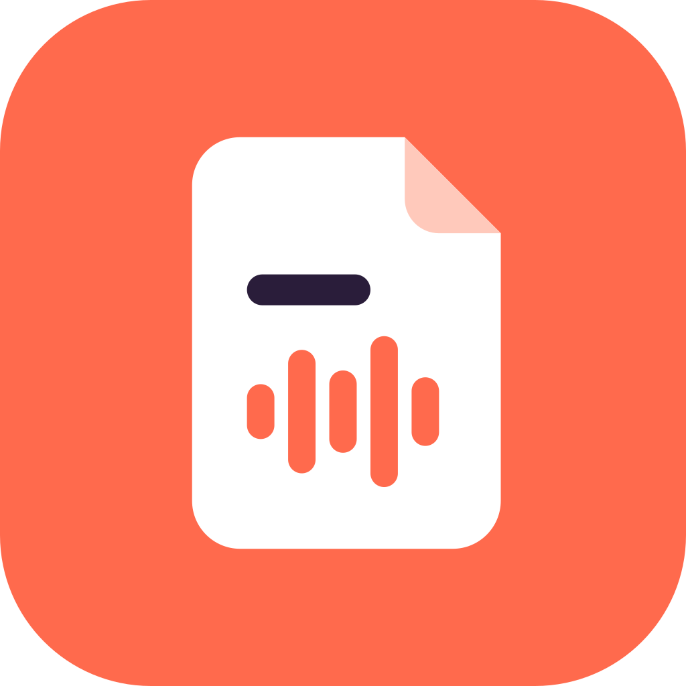

<p align="left"></p>

# WhisprNotes

Private voice notes and meeting summaries, transcribed **on your phone**, in 37 languages. Whisper transcription after you stop (with a live preview while you speak), Whisper Large-v3 Turbo accuracy on capable phones, and AI summaries with key points, action items and decisions. No account, no cloud, no ads. The interface ships in 20 languages.

## Releases

- **Android 1.0.0 (build 4, arm64-v8a):** [Download APK](https://expo.dev/artifacts/eas/EsB8wtePb7RCILVJ8EwApwiZptx73MP0JjpwRzWFJUE.apk) · [EAS build details](https://expo.dev/accounts/mdhamed238/projects/whisprnotes/builds/7af5b21d-4ca7-47b0-afc2-d1eecf69e0dd). Built from revision `0270f9c`: 20 interface languages, a live preview in every language, pause and resume, and a message with a retry when the speech model cannot be downloaded. EAS lists this build's expiration date as December 15, 2026.
- **Previous, Android 1.0.0 (build 2, arm64-v8a):** [Download APK](https://expo.dev/artifacts/eas/EAy1kwiNGnk2dPYKChr4ciiu896PCVgIV9_DTusyj_4.apk) · [EAS build details](https://expo.dev/accounts/mdhamed238/projects/whisprnotes/builds/204f2e5f-74f4-4811-a22d-84a750dcb792). Built successfully from revision `0e13bec` with the lifetime pricing and recording fixes. EAS lists this build's expiration date as December 13, 2026.

## Features

- **Transcripts in 37 languages**, free on every phone: Whisper Base (multilingual, whisper.cpp) re-transcribes the saved audio after you stop. Pick the language from the chip on the Record screen.
- **Live preview in every language** as you speak: English streams word by word (Whisper Base EN, ExecuTorch); the other languages run the multilingual Base model over a sliding window (`services/livePreview.ts`). Every step costs a full pass of the model, so the text trails the speaker by a few seconds, more on slower phones; a phone that needs over 10 seconds for a pass turns the preview off for that recording and says so (for the rest of the session once it has happened twice). Stop, Pause and Resume never wait for it: after Stop it finishes its last words in the background.
- **Pause and resume** a recording. Paused time is not recorded or counted, and the preview picks up where it left off.
- **Pro accuracy**: Whisper **Large-v3 Turbo** (whisper.cpp) on flagship phones, Whisper Small on mid-range. Word-level timings: tap any word to replay it. 99 languages with Large-v3, which also detects the spoken language itself.
- **AI summaries and titles**, on-device (Qwen3 1.7B / 0.6B via ExecuTorch): overview, key points, action items, decisions, written in the language spoken. Long meetings are summarized in parts and merged. Pro adds five styles (meeting, lecture, interview, memo, brief), custom instructions and a choice of summary language.
- **Ask this note** (Pro): ask a question about a note; the relevant parts of its transcript are picked and the answer is written on the phone.
- **Transcribe audio files** (Pro): voice memos, lectures and call recordings become notes with the same transcript, timings and summary as a recording.
- **Notes**: full-text search (SQLite FTS5) across transcripts, summaries and tags; tag filters; sort; swipe to pin or delete with undo; long-press menu.
- **Player**: real waveform (measured while recording), scrubbing, ±15 s, playback speed.
- **Export & share**: text and Markdown (with front matter and task checkboxes) for everyone; branded PDF, SRT subtitles and the original audio with Pro. Summary-only or full; optional timestamps. One-tap Markdown zip backup of everything. Exports use the app language and lay out right-to-left notes correctly.
- **Import**: Markdown, text, Evernote `.enex`, and `.zip` exports from Notion, Obsidian or Bear. "Open in WhisprNotes" from other apps. Duplicates skipped.
- **Insights**: minutes recorded, words, streaks and a 14-day chart for everyone; speaking pace, typing time saved, time-of-day and weekday habits and top tags with Pro. Computed on the phone.
- **20 interface languages**: English, French, Spanish, German, Italian, Arabic (right-to-left), Portuguese, Dutch, Turkish, Russian, Hindi, Japanese, Korean, Chinese, Polish, Indonesian, Ukrainian, Swedish, Vietnamese, Czech. Follows the phone's language, or choose one in Settings.
- **Pro** (RevenueCat): one $4.99 lifetime purchase (USD base; local store prices vary). Free tier: unlimited recording (60 minutes each; 3 hours with Pro), transcripts in every language, AI titles, 3 summaries a week, text and Markdown export, import and backup.
- **Trust**: fully offline after the one-time model downloads; no account, no analytics, no crash reporting. Onboarding explains the downloads; bundled Privacy Policy, Terms and "What's stored" pages; delete-all-data. Feedback is an optional form on the website (Settings → Send feedback).
- **Feel**: a plain docked tab bar with labels, consistent haptics (toggleable), toasts with undo, bottom sheets, native transitions, reduced-motion support, light and dark themes.

## Device tiers

Detected from RAM at launch (phones report less than marketed, so the thresholds sit below the marketed sizes). Users can override in Settings → AI models.

| Tier | Detected RAM | Transcript (Pro) | Transcript (free) | Summaries |
|---|---|---|---|---|
| Flagship (e.g. Galaxy S23 Ultra) | ≥ 6.5 GiB | Whisper Large-v3 Turbo, q5_0, 574 MB | Base | Qwen3 1.7B |
| Standard | 5–6.5 GiB | Whisper Small (multilingual) | Base | Qwen3 0.6B |
| Lite | < 5 GiB, or 32-bit Android | Base | Base | Qwen3 0.6B |

"Base" is Whisper Base EN (ExecuTorch, the live-preview model) for English and Whisper Base multilingual (whisper.cpp, q5_1, 60 MB, fetched automatically) for every other language. Recordings over 30 minutes always go to a whisper.cpp engine, which reads the file in windows. If a model fails to load, the app falls back one step and remembers it; English can fall through to the multilingual model, which runs on a different runtime. Large-v3 Turbo is downloaded on request (Settings → AI models); until then Pro uses Small.

## Architecture

```
app/                         expo-router screens
  (tabs)/index.tsx           Record: live streaming transcription, WAV to disk
  (tabs)/notes.tsx           Notes: FTS search, tags, sort, swipe, undo
  (tabs)/insights.tsx        Insights
  (tabs)/settings.tsx        Settings
  note/[id].tsx              Note: player, summary, transcript, export
  ask/[id].tsx               Ask this note (Pro)
  language.tsx               Language picker (app, transcription, summaries)
  paywall.tsx, onboarding.tsx, models.tsx, import.tsx, legal/[doc].tsx
  +native-intent.tsx         Routes files opened from other apps to import
services/
  db/                        SQLite schema/migrations, notes repo (+change events, CAS)
  ai/                        tiers, model manager, engines (whisper.rn, ExecuTorch),
                             persistent job queue, summarizer, prompts/parser
  export/                    generators (txt, md, srt), PDF template, exporter, backup
  import/                    parsers (md, txt, enex), zip budget, importer, audio-file import, incoming-URI guard
  insights/stats.ts          on-device statistics
  billing/                   RevenueCat purchases, plans, free quota
  livePreview.ts, liveWhisper.ts, liveTranscription.ts   live preview while recording
  recordingControls.ts       record / pause / resume / stop state machine
  settings*.ts, haptics.ts, wavEncoder.ts, waveform*.ts, timelineStore.ts, text.ts
components/                  UI kit (Toast, ActionSheet, SwipeableRow, …), charts, brand
content/legal/               Privacy, Terms, What's stored (Markdown; `yarn legal` embeds them)
website/                     Marketing + legal site (`yarn website`)
```

Also: `i18n/` (translations: `locales/en.ts` is the source of truth, the other nineteen are typed against it; `native/` holds the localized microphone permission text), `plugins/withBackupRules.js` (Android backup exclusions).

Key decisions:

- **SQLite, not AsyncStorage.** The old store rewrote the whole notes array on every change and could drop concurrent writes. Writes are now single statements; background results use compare-and-swap so a user's edit always wins.
- **Lists never load transcripts.** The notes list and Insights read snippets and a stored word count (`notesRepo.listNoteItems`), so their cost doesn't grow with meeting length. Full notes are read only to open, export or back up one.
- **Progress lives in memory.** Transcription progress used to be written to the note row every second, re-running every list query. It is now a small in-memory store (`services/ai/progressStore.ts`); the database hears about state changes only.
- **Background work is a persistent queue** (`services/ai/enhanceQueue.ts`). It resumes after the app is killed, waits while recording, and runs one heavy model at a time. A job that took the app down once is retried with the most conservative decoding.
- **Non-Latin scripts are transcribed safely.** Word-level timings come from one-token whisper.cpp segments, which can split a multi-byte character. Languages written without spaces use whisper's phrase segments instead, and any token-level result containing a broken character is redone at phrase level.
- **The summary model is told the language by name** and asked to keep English section headings; the parser also recognizes the headings and "none" placeholders in every interface language, because small models translate them anyway. Chunk sizes follow the script, since tokens per character vary several-fold.
- **Transcription imports come from `react-native-executorch/legacy`**: the 0.10 root API has no word timestamps.
- **Native modules are pinned** (executorch, audio-api, worklets, whisper.rn, purchases). After any native dependency change, rebuild the dev client. This release adds one: `expo-localization`.

## Privacy and feedback

The app makes two kinds of network request: model downloads (Hugging Face) and purchases (RevenueCat, the stores). There is no analytics, crash-reporting or launch-counting SDK. `react-native-executorch` would report each model download to its maker's analytics endpoint; `services/ai/quietResourceFetcher.ts` stops that, and a test runs the library's real download path to prove it (re-check it after upgrading the library). Nothing that reports should be added without changing the Privacy Policy, "What's stored", the store privacy answers (`docs/store/listing.md`) and the iOS privacy manifest in `app.json` first.

Feedback is collected outside the app: **Settings → Send feedback** opens `website/` → `/feedback` in the browser. The form has no backend. It submits to a `mailto:` address, so it opens the visitor's own mail app with the message filled in, and they send it themselves. The site's Content-Security-Policy (`website/vercel.json`) allows no scripts and only that `mailto:` form target.

## Translations

Add or change a string in `i18n/locales/en.ts`, then in each other locale; `yarn typecheck` fails on a missing key and `yarn test` checks that placeholders match and plural forms are complete. To add a language: add it to `i18n/languages.ts`, `i18n/index.ts`, `i18n/plural.ts`, `i18n/native/` and the `locales` / `supportedLocales` lists in `app.json`. Privacy Policy and Terms are English only.

## Requirements

Physical device only. iOS 17+, or Android 7+ on arm64-v8a. Node 18+, Yarn.

```bash
yarn install
yarn ios        # or: yarn android   (dev client build)
yarn test       # unit tests (Jest)
yarn typecheck
```

## License

All rights reserved.
