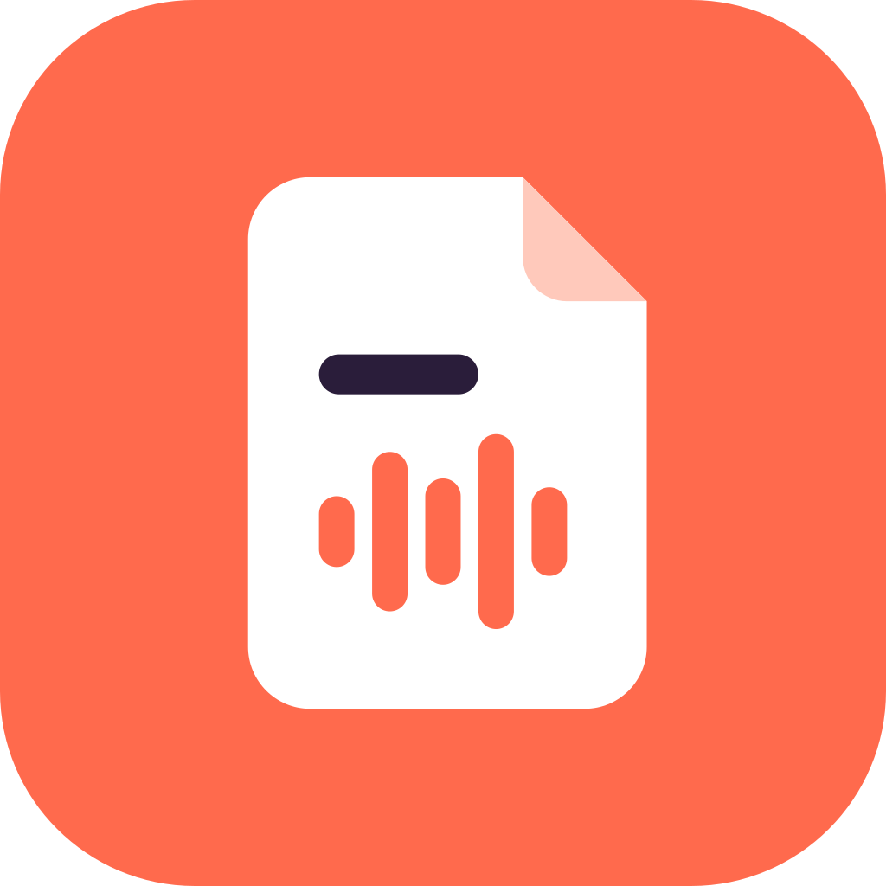

<p align="center"></p>

# WhisprNotes

Private voice notes and meeting summaries, transcribed **on your phone**. Live Whisper transcription while you speak, Whisper Large-v3 Turbo accuracy after you stop, and AI summaries with key points, action items and decisions. No account, no cloud, no tracking.

## Features

- **Live transcript** as you speak (Whisper Base EN + VAD, ExecuTorch).
- **Enhanced transcript** after recording: Whisper **Large-v3 Turbo** (whisper.cpp) on flagship phones, Whisper Small on mid-range, Base on the rest. Word-level timings: tap any word to replay it. 99 languages with Large-v3.
- **AI summaries and titles**, on-device (Qwen3 1.7B / 0.6B via ExecuTorch): overview, key points, action items, decisions. Long meetings are summarized in parts and merged.
- **Notes**: full-text search (SQLite FTS5) across transcripts, summaries and tags; tag filters; sort; swipe to pin or delete with undo; long-press menu.
- **Player**: real waveform, scrubbing, ±15 s, playback speed.
- **Export & share**: branded PDF, Markdown (with front matter and task checkboxes), text, SRT subtitles, original audio; summary-only or full; optional timestamps. One-tap Markdown zip backup of everything.
- **Import**: Markdown, text, Evernote `.enex`, and `.zip` exports from Notion, Obsidian or Bear. "Open in WhisprNotes" from other apps. Duplicates skipped.
- **Insights**: minutes recorded, words, streaks, speaking pace, typing time saved, 14-day chart, time-of-day heatmap, top tags. Computed on the phone.
- **Pro** (RevenueCat): monthly, yearly with trial, or lifetime. Free tier: unlimited recording, AI titles, 3 summaries a week, text export.
- **Trust**: onboarding that explains the one-time model downloads, bundled Privacy Policy, Terms and "What's stored" pages, delete-all-data.
- **Feel**: consistent haptics (toggleable), toasts with undo, bottom sheets, native transitions, reduced-motion support, light and dark themes.

## Device tiers

Detected from RAM at launch (phones report less than marketed, so the thresholds sit below the marketed sizes). Users can override in Settings → AI models.

| Tier | Detected RAM | Final transcript (Pro) | Summaries |
|---|---|---|---|
| Flagship (e.g. Galaxy S23 Ultra) | ≥ 7 GiB | Whisper Large-v3 Turbo, q5_0, ~574 MB | Qwen3 1.7B |
| Standard | 5–7 GiB | Whisper Small (multilingual) | Qwen3 0.6B |
| Lite | < 5 GiB, or 32-bit Android | Whisper Base EN | Qwen3 0.6B |

Free users get the Base pass (word timings, cleaner text) on every tier. If a model fails to load, the app falls back one tier and remembers it. Large-v3 Turbo is downloaded on request (Settings → AI models); until then Pro uses Small.

**Performance:** measure on device and record here (realtime factor of the Turbo pass on an S23 Ultra, summary time for a 30-minute meeting).

## Architecture

```
app/                         expo-router screens
  (tabs)/index.tsx           Record: live streaming transcription, WAV to disk
  (tabs)/notes.tsx           Notes: FTS search, tags, sort, swipe, undo
  (tabs)/insights.tsx        Insights
  (tabs)/settings.tsx        Settings
  note/[id].tsx              Note: player, summary, transcript, export
  paywall.tsx, onboarding.tsx, models.tsx, import.tsx, legal/[doc].tsx
  +native-intent.tsx         Routes files opened from other apps to import
services/
  db/                        SQLite schema/migrations, notes repo (+change events, CAS)
  ai/                        tiers, model manager, engines (whisper.rn, ExecuTorch),
                             persistent job queue, summarizer, prompts/parser
  export/                    generators (txt, md, srt), PDF template, exporter, backup
  import/                    parsers (md, txt, enex), zip budget, importer, incoming-URI guard
  insights/stats.ts          on-device statistics
  billing/                   RevenueCat purchases, plans, free quota
  settings*.ts, haptics.ts, wavEncoder.ts, waveform*.ts, timelineStore.ts
components/                  UI kit (Toast, ActionSheet, SwipeableRow, …), charts, brand
content/legal/               Privacy, Terms, What's stored (Markdown; `yarn legal` embeds them)
website/                     Marketing + legal site (`yarn website`)
```

Key decisions:

- **SQLite, not AsyncStorage.** The old store rewrote the whole notes array on every change and could drop concurrent writes. Writes are now single statements; background results use compare-and-swap so a user's edit always wins.
- **Background work is a persistent queue** (`services/ai/enhanceQueue.ts`). It resumes after the app is killed, waits while recording, and runs one heavy model at a time.
- **Transcription imports come from `react-native-executorch/legacy`**: the 0.10 root API has no word timestamps.
- **Native modules are pinned** (executorch, audio-api, worklets, whisper.rn, purchases). After any native dependency change, rebuild the dev client.

## Requirements

Physical device only. iOS 17+, or Android 7+ on arm64-v8a. Node 18+, Yarn.

```bash
yarn install
yarn ios        # or: yarn android   (dev client build)
yarn test       # unit tests (Jest)
yarn typecheck
```

## Before you ship

1. **RevenueCat:** create the project; entitlement `pro`; products `whisprnotes_pro_monthly`, `whisprnotes_pro_yearly` (with intro trial), `whisprnotes_pro_lifetime`; an offering with monthly/annual/lifetime packages. Put the public SDK keys in `app.json` → `expo.extra.revenueCat`.
2. **Website:** live at https://whisprnotes-app.vercel.app (privacy: `/privacy`, terms: `/terms`, support: `/support`). To update: `yarn website`, then from `website/` run `vercel deploy --prod` (with `--token` if `vercel login` fails on a Mac name containing ’). When you buy a domain, update `WEBSITE_URL` in `constants/config.ts` and `docs/store/listing.md`.
3. **Legal:** fill in the governing-law country and have the documents reviewed (see `docs/legal/README.md`).
4. **Stores:** copy and privacy answers in `docs/store/listing.md`.
   - Apple: Individual developer account ($99/yr). Paid Apps agreement, banking and tax forms. To sell in the EU you must declare trader status, which shows your address and phone on the App Store.
   - Google Play: personal account ($25). New personal accounts must run a closed test with at least 12 testers for 14 days before production.
5. **Measure** Turbo speed and summary time on a flagship and update this README.

## License

All rights reserved.
